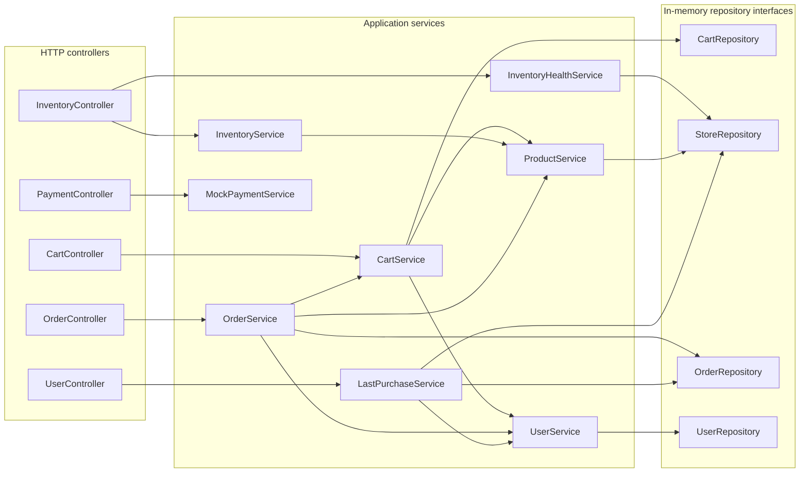
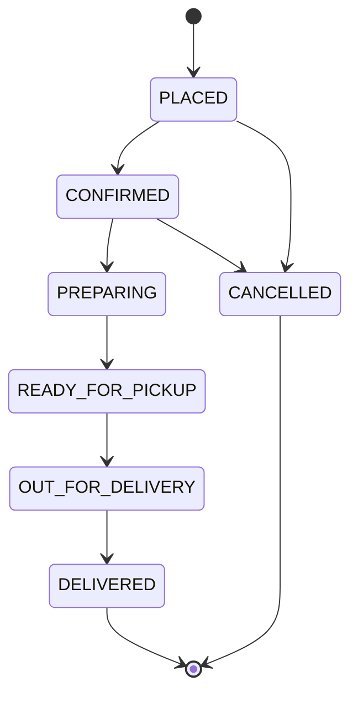

# Welcome to JOI Delivery

JOI Delivery is built for real life. For the young professional who gets home late and doesn’t have the energy to cook. For the student with an exam tomorrow and an empty fridge tonight. These aren’t exceptions — they’re everyday moments. That’s why JOI Delivery brings food and groceries to your door, fast, fresh, and right when you need them.

Customers struggle with:

- Cluttered browsing experiences that don’t understand their preferences.
- Limited customization when ordering meals or groceries.
- Unclear order status or delivery timelines.
- Poor payment experience, or failed checkouts.
- Lack of timely feedback channels to report a bad experience or appreciate a good one.

JOI Delivery was built not just as another delivery app, but as a thoughtful, technology-first platform that reimagines how essentials reach customers in the most seamless way.

# Introducing JOI Delivery

JOI Delivery, launched in 2024, is a hyperlocal delivery app designed to bring food and groceries to your doorstep in under 45 minutes. With the tagline "Speed meets convenience," it connects customers to nearby restaurants and stores through a seamless digital experience. The app solves the hassle of long wait times and limited local options by offering real-time tracking, instant order updates, and a wide network of trusted vendors.

## Business Goals

- Differentiated Value Proposition & Niche Dominance
- Deliver Unmatched Customer Experience & Loyalty
- Superior Operational Efficiency & Cost Advantage
- Robust & Engaged Partner Ecosystem

## Why they need Thoughtworks help

As JOI Delivery continues to grow and serve more neighborhoods, we’re scaling our platform to handle increasing demand, enhance user experience, and support smarter delivery logistics. They're looking for passionate developers to help us build robust, efficient, and scalable solutions that power everything from order placement to real-time tracking.
Your expertise will directly impact how quickly and reliably customers receive their essentials—and how smoothly local vendors and delivery partners operate within our ecosystem.

### Users/Customers

Sample user profiles are available in the repository to support development and testing scenarios.

| UserId   | FirstName | LastName|
|----------|-----------|---------|
| user101  | John      | Doe     |
| user102  | Rachel    | Zane    |

### Stores

Sample store data seeded for development purposes only.

| StoreId  | OutletName     |
|----------|----------------|
| store101 | Fresh Picks    |
| store102 | Natural Choice |

### Grocery Products

Dummy Products for Stores to sell and users to buy from.

| ProductId  | ProductName | StoreRefId |
|------------|-------------|------------|
| product101 | Wheat Bread | store101   |
| product102 | Spinach     | store101   |
| product103 | Crackers    | store101   |

### Restaurant Meals

The seeded restaurant `restaurant101` (Spice Kitchen) provides prepared meals.
Meal prices and availability are stored on `FoodProduct`, and each meal belongs
to its restaurant's menu. Grocery stores and restaurants share the outlet repository.

Register catalog products through the outlet's `addProduct` method. Products sold
by different outlets use separate instances and distinct product IDs. Registration
rejects an existing owner from another outlet and duplicate IDs within the same
outlet. Menus and grocery inventories are exposed as read-only snapshots.

| ProductId | ProductName | OutletId | Unit Price | Available Stock |
|-----------|-------------|----------|------------|-----------------|
| meal101 | Chicken Curry | restaurant101 | 25.00 | 20 |
| meal102 | Vegetable Curry | restaurant101 | 18.00 | 20 |

## Current Architecture

This is a single Spring Boot backend. The business introduction describes the
product scenario; the implemented backend currently covers catalogs, carts,
restaurant customization, order placement/status, manual stock updates, inventory
health, the last purchased outlet and standalone mock payment decisions. Real
payment processing, payment-to-checkout integration, delivery estimates/tracking,
recommendations and feedback are not implemented.

### Components and Dependencies



| Layer/package | Responsibility |
|---------------|----------------|
| `controller` | HTTP routes, request validation, response statuses and exception translation |
| `dto.request` | Validated inputs for additions, quantity changes, stock, orders and mock payments |
| `dto.response` | API snapshots, mock payment decisions and clear error messages |
| `service` | Cart rules, catalog lookup, checkout, stock updates, health classification, history lookup and mock payment decisions |
| `domain` | Catalog entities, cart/item values, the order state machine and mock payment statuses |
| `exception` | Explicit missing-resource, cart/stock, price-change and order-transition errors |
| `repository` | Interfaces and `InMemory*Repository` implementations backed by instance-owned concurrent maps |
| `config` | Repository wiring and an injectable clock for order timestamps and mock card expiry checks |
| `seedData` | Startup users, grocery stores, restaurant menus and products |

`RepositoryConfiguration` calls `SeedData.create()` once per Spring context and
shares that seed instance with its user and outlet repositories; cart and order
repositories start empty. Each context receives fresh users, outlets and nested
products for the same sample users and catalog. Services within a context share
its repositories and entities. Integration tests restore seed state they modify
because test classes can reuse the same cached Spring context.

All runtime state is in memory and disappears on restart. The H2/JPA settings in
`application.yaml` are leftover configuration: the build has no H2/JPA dependencies
or database-backed repositories.

### Domain Model and Identity

| Model | Meaning and identity |
|-------|----------------------|
| `Outlet<P>` | Abstract catalog owner with typed registration and lookup operations |
| `Restaurant` / `FoodProduct` | Restaurant menu and prepared meal; choices belong to the cart line |
| `GroceryStore` / `GroceryProduct` | Grocery inventory and product stock/threshold information |
| `Cart` | One lazily created cart per user ID, containing products from at most one outlet |
| `CartItem` | Immutable line with a generated `cartItemId`, copied product details/price, quantity and optional meal choices |
| `Order` | Saved order ID, user/outlet IDs, copied immutable lines, creation time and mutable current status |
| `User` | User details and internal `lastOrderId`; the last purchased outlet is resolved from that order |
| `PaymentStatus` | `ACCEPTED` or `REJECTED` mock decision; no persisted payment entity |

`cartId` identifies the whole cart; `cartItemId` identifies a selected line;
`productId` identifies a catalog entry. Two versions of one meal have the same
product ID and different line IDs. Quantity changes retain the line ID, price and
choices. Checkout copies retain line IDs and choices and use the validated catalog
price/details. Saved orders are independent of later cart changes.

Product IDs are intended to be distinct across outlets. Registration enforces
ownership and duplicate IDs within an outlet; global ID uniqueness is not enforced.
Cart and inventory operations use outlet-scoped lookup. The unscoped
`ProductService.getProduct(productId)` can be ambiguous if the convention is violated.

### Request Flows and Consistency

- **Add/update cart:** validate the user, atomically get/create its canonical cart,
  hold the cart monitor, validate catalog ownership/stock, then add or replace an
  immutable line. Decreases/removal require no catalog lookup.
- **View cart:** copy its item list under the same monitor. The list and items are
  detached; `user` and `outlet` still reference live domain objects. This is not a
  deep snapshot of the nested catalog.
- **Checkout:** hold the cart monitor, validate and copy lines, save the order,
  update the user's last-order reference, then clear the cart. If the history write
  fails, restore its previous reference and attempt to remove the new order.
- **Mock payment:** validate request fields and compare the expiration month with
  the injected clock, then return a deterministic acceptance or rejection. The
  service has no repository dependency and does not change carts or orders.
- **Inventory:** updates lock one product through read/validate/write/response
  capture. Cart/checkout availability checks and health reads use that same product
  monitor. Locks are acquired in cart-to-product order; inventory updates never
  acquire a cart lock. A store health report captures products individually, not
  as one atomic store-wide snapshot.
- **Catalog registration:** outlet/product monitors protect registration checks and
  ownership assignment. Menu/inventory collections are read-only snapshots, but
  the catalog entities inside them remain mutable.

These locks coordinate one JVM. Stock is not reserved or deducted at checkout,
and order/history compensation is not a durable database transaction. `PUT` stock
and absolute quantity updates are retry-safe in their effects; repeated cart-add
or stock-adjustment `POST` requests apply again because no deduplication key exists.

### Known Gaps to Address

The existing tests cover normal flows and several concurrency/failure cases, but
these behaviors still need fixes or explicit policy:

| Area | Current gap |
|------|-------------|
| Order status changes | Transition validation/mutation is not synchronized; a failed repository save leaves the live stored order mutated. |
| Price reconfirmation | Checkout reports changed prices without placing an order; accepting the new price currently requires removing/re-adding affected cart lines. There is no dedicated price-refresh/reconfirmation endpoint. |
| Catalog consistency | Grocery price/owner aliases can disagree with inherited fields; public identity/owner setters can bypass registration invariants. |
| Caller identity | No authentication/authorization is implemented. Client-supplied user IDs select carts/history; order and stock routes do not enforce caller roles. |
| Payments | Only mock acceptance/rejection is implemented; there are no real charges, payment persistence, refunds or checkout integration. |
| Persistence and inventory | No durable storage, cross-process locking, inventory reservation or automatic deduction is implemented. |

## API

The application must be running to call these endpoints; see the
[run instructions](#useful-gradle-commands) below.
Quantity/stock inputs must be integer JSON numbers. Decimal numbers, including
`1.0`, return HTTP 400 before reaching the services. Enum choices use their string
names; numeric enum ordinals also return HTTP 400.

| Method | Route | Success response |
|--------|-------|------------------|
| POST | `/cart/product` | 200, added `CartItem` |
| GET | `/cart/view?userId=...` | 200, `Cart` item-list snapshot |
| PATCH | `/cart/items/{cartItemId}` | 200, updated `Cart` snapshot |
| POST | `/orders` | 201, `Order` and `Location`; 200 with a message if prices changed and no order was placed |
| GET | `/orders/{orderId}` | 200, saved `Order` |
| PATCH | `/orders/{orderId}/status` | 200, updated `Order` |
| POST | `/payments` | 200, mock `PaymentResponse` with `ACCEPTED` or `REJECTED` |
| GET | `/users/{userId}/last-purchase` | 200, last purchase; 204 if none |
| GET | `/inventory/health?storeId=...` | 200, grocery health report |
| PUT | `/inventory/{outletId}/products/{productId}/stock` | 200, stock response |
| POST | `/inventory/{outletId}/products/{productId}/stock-adjustments` | 200, stock response |

### Add Product to Cart

```http
POST /cart/product
Content-Type: application/json
```

Request Body (`quantity` must be greater than zero)
```json
{
  "userId": "user101",
  "productId": "product101",
  "outletId": "store101",
  "quantity": 2
}
```

Returns the added `CartItem` directly with HTTP 200. Example for a unit price of 10.50:
```json
{
  "cartItemId": "afbfab53-a215-43ef-ab7d-495b5ffb847e",
  "productId": "product101",
  "productName": "Wheat Bread",
  "quantity": 2,
  "unitPrice": 10.50,
  "totalPrice": 21.00
}
```

Adding a product checks the combined quantity already in the cart against available stock.
It does not reserve or decrease stock. Each successful addition creates a cart item;
its response contains the quantity from that addition.

For a restaurant meal, the same endpoint also accepts `spiceLevel` and
`utensilsNeeded`:

```json
{
  "userId": "user101",
  "outletId": "restaurant101",
  "productId": "meal101",
  "quantity": 2,
  "spiceLevel": "MEDIUM",
  "utensilsNeeded": true
}
```

The added item is returned directly:

```json
{
  "cartItemId": "7bdbf199-32bb-40aa-aa6a-a4c8d60d2be7",
  "productId": "meal101",
  "productName": "Chicken Curry",
  "quantity": 2,
  "unitPrice": 25.00,
  "totalPrice": 50.00,
  "spiceLevel": "MEDIUM",
  "utensilsNeeded": true
}
```

`spiceLevel` accepts `NONE`, `MILD`, `MEDIUM`, or `HOT` and defaults to `NONE`.
`utensilsNeeded` defaults to `false`. Choices apply to every unit in that cart
item and do not change its price. Separate additions can have different choices;
stock checks include the quantities of all items for the same product.

Grocery items omit both customization fields from responses. Providing either
non-null option for groceries, including `utensilsNeeded: false`, returns HTTP 400.
Unknown spice values also return HTTP 400.

Each addition creates a distinct `cartItemId`, even for the same product and
customization. A cart's `cartId` identifies the whole cart; `cartItemId` identifies
one line. IDs are included in both add-product responses and viewed cart items.

An empty cart takes its outlet from the first successful addition. While it
contains items, additions from another store or restaurant return HTTP 400.
A rejected addition leaves both the existing items and outlet unchanged.

If the combined quantity exceeds available stock, both cart addition and checkout
return HTTP 409 with a message such as:

```json
{
  "message": "Requested quantity 21 exceeds available stock 20 for product meal101"
}
```

### Change Cart Item Quantity

```http
PATCH /cart/items/7bdbf199-32bb-40aa-aa6a-a4c8d60d2be7
Content-Type: application/json
```

```json
{
  "userId": "user101",
  "quantity": 3
}
```

Returns the updated `Cart` snapshot with HTTP 200. The absolute target quantity
changes only the selected line, retaining its `cartItemId`, captured name, unit
price and customization. Other lines, including another spice version of the
same meal, are unchanged. Line totals are recalculated from the captured price.

Quantity zero removes the line; removing the final line also clears the cart's
outlet. Negative or missing quantities and blank/missing user IDs return HTTP 400.
Unknown users or item IDs, including an item belonging to another user's cart,
return HTTP 404. A removed item ID no longer exists; adding the product again
creates a new ID.

Increases check combined quantities across all lines for the product and return
HTTP 409 without mutation if stock is insufficient. Reductions and removal remain
allowed after stock drops or the product is removed from the catalog. These
operations use the existing cart lock; stock checks also use the product lock.

Setting the same target quantity again does not add units or change item identity.
Concurrent absolute updates to the same item use the last processed target value.
Cart quantity changes do not change inventory stock.

### View Cart

```http
GET /cart/view?userId=user101
```

Returns the complete `Cart` directly with HTTP 200:

| Field | Contents |
|-------|----------|
| `cartId` | Cart identifier |
| `outlet` | Store or restaurant, including inventory where exposed by the outlet; initially `null` for a new empty cart |
| `cartItems` | Items with the same fields as the add-product response above |
| `user` | Cart owner; the user's cart back-reference is omitted |

Cart items retain their captured names and unit prices. Viewing a cart does not
look up its items again in the product catalog.

For a valid user, the cart is created lazily on first access with a generated UUID,
the correct owner and no outlet. Later requests reuse the same cart. An unknown
user returns HTTP 404 and does not create a cart. Seed data supplies users and
catalogs; cart storage belongs to the in-memory cart repository.

Viewing returns a detached cart with an immutable snapshot of its item list.
Additions and checkout coordinate on the same cart lock, so concurrent requests
cannot bypass that cart's outlet or combined-quantity checks.

### Place Order

```http
POST /orders
Content-Type: application/json
```

Request Body
```json
{
  "userId": "user101"
}
```

Checkout requires a nonempty cart and rechecks product availability and prices.
It copies the items into an order, preserving each meal's spice level and utensils
selection. Grocery order items omit both customization fields.

Checkout of an empty cart returns HTTP 409 with a clear error message.

If a catalog price differs from the captured cart price, checkout returns HTTP 200
with a message and no `Location` header:

```json
{
  "message": "Order not placed: price for product meal101 changed from 25.00 to 27.00."
}
```

No order is saved, and the cart and last-purchase reference stay unchanged. Clients
must distinguish this HTTP 200 message from the HTTP 201 order response. Remove
and re-add the affected line to capture the current price before retrying checkout.

A successful checkout returns HTTP 201 with a `Location: /orders/{orderId}` header
and the order directly in the response body. Example after adding two Chicken Curry
meals with medium spice and utensils requested (ID and timestamp are generated):

```json
{
  "orderId": "7e5f6e92-21c0-4b72-9b64-778fbf2957b5",
  "userId": "user101",
  "outletId": "restaurant101",
  "items": [
    {
      "cartItemId": "7bdbf199-32bb-40aa-aa6a-a4c8d60d2be7",
      "productId": "meal101",
      "productName": "Chicken Curry",
      "quantity": 2,
      "unitPrice": 25.00,
      "totalPrice": 50.00,
      "spiceLevel": "MEDIUM",
      "utensilsNeeded": true
    }
  ],
  "createdAt": "2026-11-16T10:00:00Z",
  "status": "PLACED",
  "totalPrice": 50.00
}
```

After the order is saved, the cart's items are cleared. The empty cart can then
accept products from another outlet. Later cart changes do not alter the saved order.

Cart locking applies within one application instance. Stock is checked but is not
reserved or deducted; preventing overselling across different customers requires
a separate atomic inventory operation.

### Mock Payment

```http
POST /payments
Content-Type: application/json
```

This standalone endpoint simulates a payment decision. It does not charge a card,
place an order, clear a cart or change an order's status. `POST /orders` remains
independent of this mock decision.

Request Body (use fictitious card details):

```json
{
  "cardNumber": "4111111111111111",
  "cvv": "123",
  "expirationDate": "2099-12"
}
```

| Field | Format |
|-------|--------|
| `cardNumber` | Required string containing 13–19 ASCII digits, without spaces or separators |
| `cvv` | Required string containing 3–4 ASCII digits; leading zeros are retained |
| `expirationDate` | Required string in `YYYY-MM` format with a month from `01` to `12` |

Well-formed requests return HTTP 200 with a decision and a short message:

```json
{
  "status": "ACCEPTED",
  "message": "Mock payment accepted."
}
```

The rules are evaluated in this order:

| Condition | Status | Message |
|-----------|--------|---------|
| Expiration month is before the current month | `REJECTED` | `Card has expired.` |
| Current/future expiration month and card number ends with `0000` | `REJECTED` | `Payment declined. Try another card.` |
| Other well-formed request | `ACCEPTED` | `Mock payment accepted.` |

The current expiration month is valid. These rules simulate outcomes; they do not
verify an issuer, card balance or CVV. Card details are not persisted, logged or
echoed in the response.

Missing fields, malformed field values or an unreadable request return HTTP 400
with a safe error message. For example, an invalid expiration month returns:

```json
{
  "message": "Expiration date must use YYYY-MM with a valid month"
}
```

### View Order

```http
GET /orders/{orderId}
```

Returns the saved order directly with HTTP 200, including item quantities, prices,
meal customizations, total and current status. An unknown order ID returns HTTP 404.

### Change Order Status

```http
PATCH /orders/{orderId}/status
Content-Type: application/json
```

```json
{"status":"CONFIRMED"}
```

The domain allows these transitions; delivered and cancelled orders are terminal:



Updates currently record only the current status, without a status-event history
or delivery estimate. Invalid transitions return HTTP 409 with a message such as
`Cannot transition order from PLACED to DELIVERED`, leaving the status unchanged.
Synchronizing concurrent status changes and handling status-save failures remain
review follow-ups.

### Last Purchase

```http
GET /users/{userId}/last-purchase
```

Returns HTTP 200 with the user's most recently placed order and its outlet:

```json
{
  "orderId": "7e5f6e92-21c0-4b72-9b64-778fbf2957b5",
  "outletId": "restaurant101",
  "outletName": "Spice Kitchen",
  "orderedAt": "2026-11-16T10:00:00Z"
}
```

A valid user with no previous order receives HTTP 204 with no body. An unknown
user receives HTTP 404. The reference is updated only after an order is saved;
failed checkouts leave the previous reference unchanged. Later cancellation does
not change which order was most recently placed.

Only the last order ID is stored on the user; outlet ID and time come from the
saved order, and the outlet name comes from the current catalog. If that outlet
is unavailable, its ID is retained and `outletName` is `null`. History is in memory
and is lost when the application restarts.

### Inventory Health

```http
GET /inventory/health?storeId=store101
```

Returns HTTP 200 with the store ID, store name and stock health for each product.
Products are sorted by product ID.

```json
{
  "storeId": "store101",
  "storeName": "Fresh Picks",
  "products": [
    {
      "productId": "product101",
      "productName": "Wheat Bread",
      "availableStock": 30,
      "threshold": 10,
      "status": "HEALTHY"
    },
    {
      "productId": "product102",
      "productName": "Spinach",
      "availableStock": 30,
      "threshold": 10,
      "status": "HEALTHY"
    },
    {
      "productId": "product103",
      "productName": "Crackers",
      "availableStock": 30,
      "threshold": 10,
      "status": "HEALTHY"
    }
  ]
}
```

| Stock condition | Status |
|-----------------|--------|
| Stock is zero | `OUT_OF_STOCK` |
| Stock is positive and at or below the threshold | `LOW_STOCK` |
| Stock is above the threshold | `HEALTHY` |

An existing empty store, such as `store102`, returns HTTP 200 with
`{"storeId":"store102","storeName":"Natural Choice","products":[]}`.
Missing or blank `storeId` returns HTTP 400;
an unknown ID returns HTTP 404. Restaurant IDs return HTTP 400 because restaurant
stock-health thresholds have not been defined.

The report copies the current stock and threshold values without changing inventory.
Negative stock or threshold values are treated as invalid catalog data and fail
the report rather than produce a misleading status.

### Update Inventory Stock

Both grocery products and restaurant meals support stock updates. To set an
absolute nonnegative count:

```http
PUT /inventory/store101/products/product101/stock
Content-Type: application/json
```

```json
{"availableStock":40}
```

To add or subtract a quantity:

```http
POST /inventory/store101/products/product101/stock-adjustments
Content-Type: application/json
```

```json
{"delta":-3}
```

Both return HTTP 200 with the resulting count. After the two examples above:

```json
{
  "outletId": "store101",
  "productId": "product101",
  "availableStock": 37
}
```

For meals, use the restaurant ID and meal ID in the same URL pattern. Absolute
updates are idempotent; each adjustment request applies its delta once.

Missing values, negative absolute counts, zero adjustments and numeric overflow
return HTTP 400. An adjustment that would make stock negative returns HTTP 409
without changing inventory. Unknown outlet/product combinations return HTTP 404.

Updates and availability reads use the same product lock. Inventory changes do
not rewrite cart quantities; checkout rechecks current stock. Stock reservation
and automatic checkout deduction remain separate features.

## Tech Requirements

The project requires Java 25. If you have multiple JVMs on your machine, you might want to
consider using a tool such as [sdkman](https://sdkman.io/) to handle switching between versions.

The project makes use of Gradle and uses the Gradle wrapper, which means you don't need Gradle installed.

### Installing Java

Install java using homeBrew
```console
brew install openjdk@25
```

Installing java on Windows, [refer](https://www.java.com/en/download/help/windows_manual_download.html#xd_co_f=NzA3YTZmNzAtOTEzMS00OWFiLTk2NjUtODg0NjNhMjRhMjkw~)

Other ways to Download and install java, [refer](https://www.oracle.com/in/java/technologies/downloads/#java25).

#### Verify Java Version Installed

```console
java -version
```

### Useful Gradle commands

#### Build the project

Compiles the project, runs the test and then creates an executable JAR file
```bash
$ ./gradlew build
```

#### Run the application

Run the application which will be listening on port ```8080```.
```bash
$ ./gradlew bootRun
```

Run the application using Java and the executable JAR file produced by the Gradle ```build``` task. The application will be listening on port ```8080```.
```bash
$ java -jar  build/libs/joi-delivery-java.jar
```

#### Run the tests

All tests live in `src/test/java` and run through the same Gradle `test` task:

| Test type | Purpose |
|-----------|---------|
| Plain JUnit and Mockito tests | Domain rules, service behavior, repositories and coordinated concurrency/failure cases |
| `@WebMvcTest` with `@MockitoBean` | Request binding/validation, response JSON and HTTP error translation |
| `@SpringBootTest` with MockMvc | Real HTTP-layer flows through services and configured in-memory repositories |

Run the complete suite:

```bash
./gradlew test
```

Run Gradle verification, which includes that same test suite:

```bash
./gradlew check
```

There is no separate functional-test source set or task in the current build.
To select a service test or the named HTTP integration test classes:

```bash
./gradlew test --tests '*CartServiceTest'
./gradlew test --tests '*IntegrationTest'
```

Regression coverage includes fractional/numeric-enum input rejection and HTTP
price/status conflicts, plus separate-context seed isolation. Review follow-up
coverage should include concurrent order-status changes and status-save failure.

#### List all Gradle tasks

List all the tasks that Gradle can run, such as ```build ``` and ```test```.
```bash
$ ./gradlew tasks
```

> The build selects the Java 25 toolchain; the Gradle wrapper supplies Gradle.
